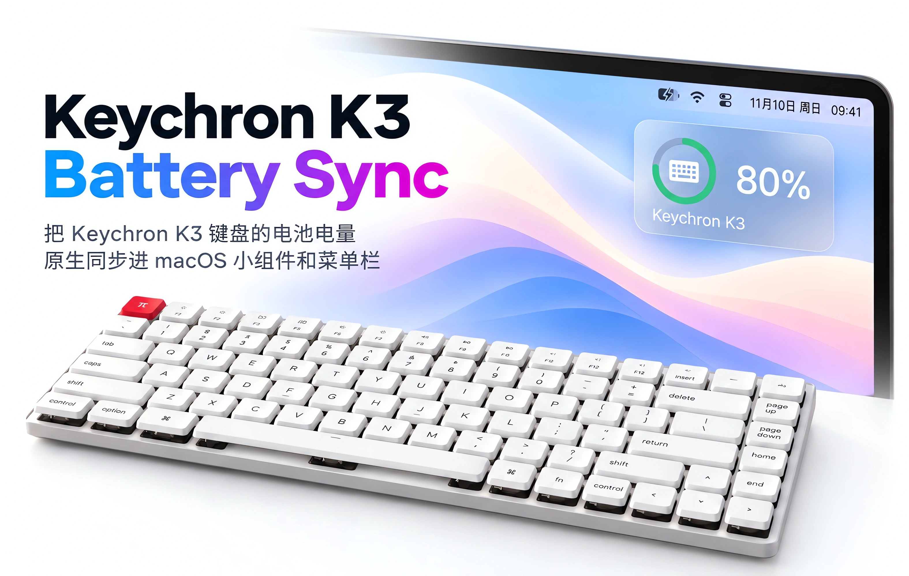

<div align="center">

# Keychron K3 Battery Sync

把 Keychron K3 键盘的电池电量原生同步进 macOS 小组件和菜单栏


<br>



</div>

## 特性

- **小组件**：小组件原生显示 Keychron K3 电池电量，并在电量 ≤20% 变红
- **低电量弹窗提醒**：20% 和 10% 各提醒一次
- **菜单栏（默认隐藏）**：显示电量，≤20% 变红
- **即时响应**：蓝牙连上 / 断开由 HID 设备树回调驱动，不等轮询
- **智能轮询**：断开或锁屏时暂停，连上 / 解锁恢复

## 安装

两种装法，任选其一。

### 方式一：下载预编译包（推荐）

从 Releases 页下载 `K3BatterySync-arm64.zip`，解压后在终端中进入目录运行：

```bash
./K3BatterySync.sh install
```

> 预编译包只支持 Apple Silicon（arm64）。Intel Mac 请走下面的「方式二：从源码编译」。

### 方式二：从源码编译

Intel 和 Apple Silicon 都能用 —— 本机编译，架构自动匹配。

```bash
./build.sh                  # 编译出 K3BatterySyncService
./K3BatterySync.sh install  # 装 LaunchAgent 并立即启动
```

### 开「输入监控」权限

两种方式装完都还差这一步，否则读不到键盘。

第一次安装时，服务启动会**自己弹窗申请**：点「打开系统设置」进到「隐私与安全性 → 输入监控」，把 `K3BatterySyncService` 打开，再 `./K3BatterySync.sh restart` 生效。

没弹出来（点掉了 / 漏了）或重编译过（ad-hoc 签名下 cdhash 变了、旧授权作废）时，再手动补：

1. 系统设置 → 隐私与安全性 → 输入监控
2. 删掉列表里的旧条目，点 `+` 按 `⌘⇧G` 粘贴 `K3BatterySyncService` 的绝对路径
3. `./K3BatterySync.sh restart`

> 没授权时服务会自己退出、不会空转。

## 使用

| 命令 | 作用 |
| --- | --- |
| `./K3BatterySync.sh install` | 安装脚本并开启自启动 |
| `./K3BatterySync.sh status` | 看状态 |
| `./K3BatterySync.sh restart` | 重启（一般在改完权限后使用） |
| `./K3BatterySync.sh stop` | 停止且不再自启 |
| `./K3BatterySync.sh uninstall` | 卸载 |
| `./K3BatterySync.sh hide` / `show` | 隐藏 / 显示菜单栏图标（默认隐藏） |
| `./K3BatterySync.sh debug on` / `off` | 调试日志开关（默认关） |

默认运行时不写日志；`debug on` 后写入 `~/Library/Logs/k3batterysync.log`。

## 工作原理

Keychron K3 通过蓝牙经典 HID 上报电量（report ID 3），但 macOS 的蓝牙 UI 不显示第三方蓝牙经典设备的电量。本工具用 IOKit 读 HID report，再通过 Accessory Power Source SPI 注册进原生电池小组件中。

```
K3 ── HID report 3 ──▶ K3Reader ──▶ AppDelegate ──▶ PowerSource ──▶ 原生电池小组件
                                         ├─▶ 菜单栏图标
                                         └─▶ Notifier ──▶ 低电量横幅

触发 AppDelegate 读取的事件：
  1. Watcher：蓝牙连上 / 断开
  2. Timer：每 120 秒轮询（断开或锁屏时暂停）
  3. 系统事件：屏幕唤醒 / 解锁
```

- report 3 返回 8 字节：`byte[1]` 是电量百分比，`byte[2..8]` 是键盘蓝牙地址
- 三个 IOKit SPI（`IOPSCreatePowerSource` 等）是私有符号，通过 `dlsym` 调用，无需 root、entitlement 或关 SIP

## 项目结构

```
Keychron-K3-Battery-Sync/
  build.sh                   编译脚本
  K3BatterySync.sh           控制脚本（install / status / restart …）
  K3BatterySyncService       编译产物（实际运行的服务）
  Sources/
    main.swift               菜单栏 + 轮询 + 生命周期
    K3.swift                 读 HID report 3 + 权限
    PowerSource.swift        注册配件电源（IOKit SPI）
    Watcher.swift            HID 设备进出回调
    Notifier.swift           系统横幅
    Prefs.swift              落盘偏好 + 跨进程广播
  k3-battery-read/           验证思路能否套到别的键盘
```

## 已知限制

- 只支持 Keychron K3
- 读不到充电状态：目前只能读取电量百分比，无法直接获取充电状态。虽然可以通过电量变化来推断，但延迟比较大，所以暂时没做。
- 电量显示随进程存亡：进程退出后小组件中的电量显示立刻消失

## 参考

[bkovacev/keychron-macos](https://github.com/bkovacev/keychron-macos) —— 走同一个 macOS 机制，但 K10 Pro 的模块没有电量字段、需要刷改过的 QMK 固件；K3 有 report 3，不用动固件。
